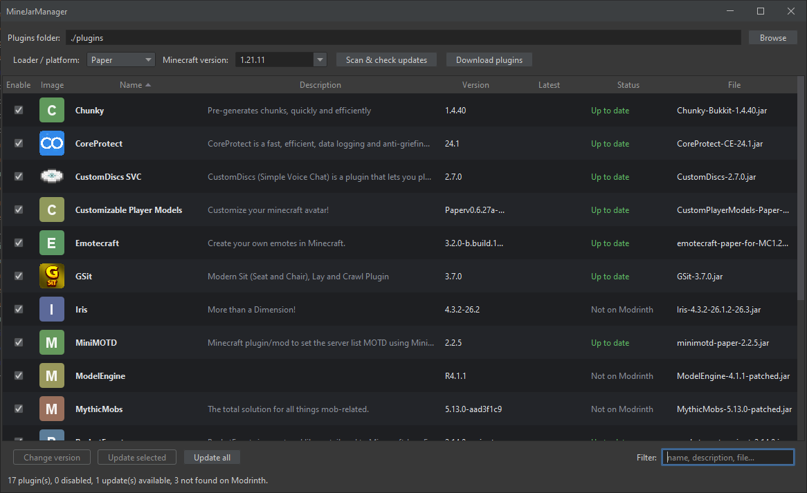

# MineJarManager
A Java GUI for managing Minecraft server plugins or mods through [Modrinth](https://modrinth.com).
Vibecoded & tuned! **Report any issues!**



## Features
+ Easy to use plugin & mod downloader for servers
+ Checks for updates
+ Disable plugins or mods

## Build & run

```bash
./gradlew shadowJar
```